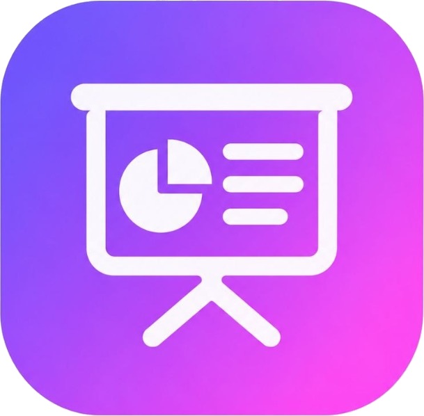

# شريحتك (Shareehatok) 🎓✨
### المنصة الأكاديمية الذكية لتوليد العروض والبحوث المنهجية بالذكاء الاصطناعي

<p align="center">
  
</p>

<p align="center">
  منصة ويب متقدمة لتوليد عروض PowerPoint الأكاديمية الاحترافية المتوافقة مع المعايير الجامعية (مقدمة وإشكالية + مباحث ومطالب متخصصة + خاتمة وتوصيات ومراجع)، مدعومة بنماذج <strong>Google Gemini API</strong> المتقدمة ومنهجية <strong>PPT-Master</strong>.
</p>

---

## 🌟 المميزات الرئيسية

1. **نظام الإعداد الذكي على 3 خطوات (3-Step Guided Wizard):**
   - **الخطوة 1: إعداد الـ API:** ربط مفتاح Google Gemini وتحديد النموذج الأنسب (Gemini 3.8 Flash, Gemini 2.5 Flash, Gemini 3.8 Pro) مع تخزين آمن ومحلي في المتصفح.
   - **الخطوة 2: البيانات والتأصيل الأكاديمي:** إدخال التخصص الأكاديمي، أسماء الطلبة، الأستاذ المشرف، اسم الموديل/المقياس، الجامعة والكلية، واختيار النمط البصري للقالب.
   - **الخطوة 3: خطة البحث والتوليد:** صياغة عنوان البحث، وتحديد دقيق لعدد المباحث والمطالب وعدد الشرائح المستهدفة مع معاينة حية للمعادلة الهيكلية.

2. **منهجية PPT-Master الأكاديمية:**
   - خطة بحث منهجية متكاملة وفق الهيكل الجامعي المعتمد: (غلاف + خطة العرض + مقدمة وإشكالية + 3 مباحث رئيسية × 3 مطالب = 9 مطالب + خاتمة وتوصيات ومراجع).
   - تنوع تحليلي شامل لكل شريحة (تعريفات، مقارنات، مؤشرات إحصائية، مراحل متسلسلة، مصفوفات بيانات).
   - استنتاج جوهري وخلاصات تنفيذية (*Executive Takeaways*) في أسفل كل شريحة.
   - منع تكرار الشرائح المستمرة بدون داعٍ (*Zero Continuation Slides*).

3. **أيقونات متجهة نقية (UIcons):**
   - استخدام أيقونات Flaticon UIcons المتجهة الموحدة والمدمجة ذاتياً بدون صور خارجية مكسورة.

4. **تصدير أصلي مزدوج:**
   - **PowerPoint (.pptx):** تصدير شرائح PowerPoint حقيقية قابلة للتحرير والتعديل مع أشكال متجهة وتنسيقات نصية وألوان كاملة.
   - **PDF عالي الدقة:** تصدير مباشر لكافة الشرائح بصيغة PDF معدّة للعرض والطباعة.

5. **معاينة تفاعلية حية (Interactive Live Preview):**
   - معاينة بنسبة 16:9 مع شريط مصغرات جانبي وتحكم كامل عبر الأسهم ولوحة المفاتيح والشاشة الكاملة (*Fullscreen*).

---

## 🛠️ التقنيات المستخدمة

- **الواجهة:** HTML5, Modern CSS (Vanilla CSS, Dark Mode, Custom Themes), JavaScript (ES Modules).
- **أداة البناء والتطوير:** [Vite](https://vitejs.dev/)
- **محرك الذكاء الاصطناعي:** Google Gemini API (Gemini 3.8 Flash / Pro)
- **مكتبة توليد الباوربوينت:** [PptxGenJS](https://gitbrent.github.io/PptxGenJS/)
- **الأيقونات:** Flaticon UIcons Vector System + Lucide

---

## 🚀 التشغيل السريع محلياً

### 1. المتطلبات:
- تثبيت [Node.js](https://nodejs.org/) (الإصدار 18 أو أحدث).

### 2. التثبيت والتشغيل:
```bash
# تثبيت الحزم والمكتبات
npm install

# تشغيل خادم التطوير المحلي
npm run dev
```

افتح المتصفح على: `http://localhost:5173`

### 3. بناء النسخة الإنتاجية:
```bash
npm run build
```

### 4. تشغيل الاختبارات الآلية:
```bash
node test/run-tests.js
```

---

## 📄 الترخيص

هذا المشروع متاح ومطور للأغراض الأكاديمية والبحثية.
